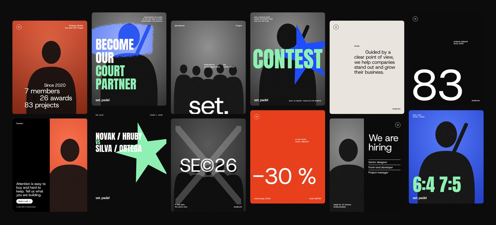
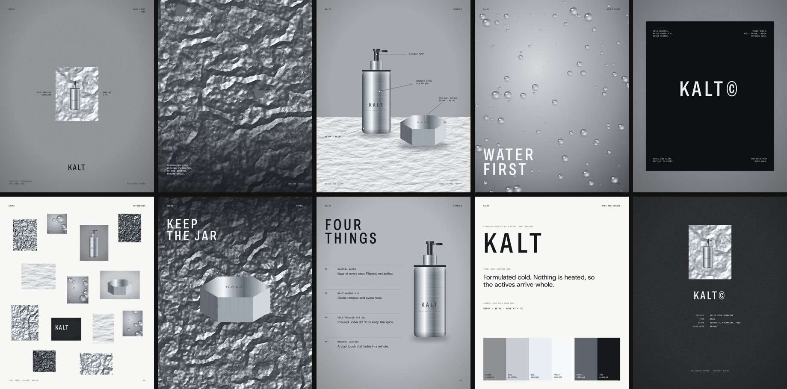
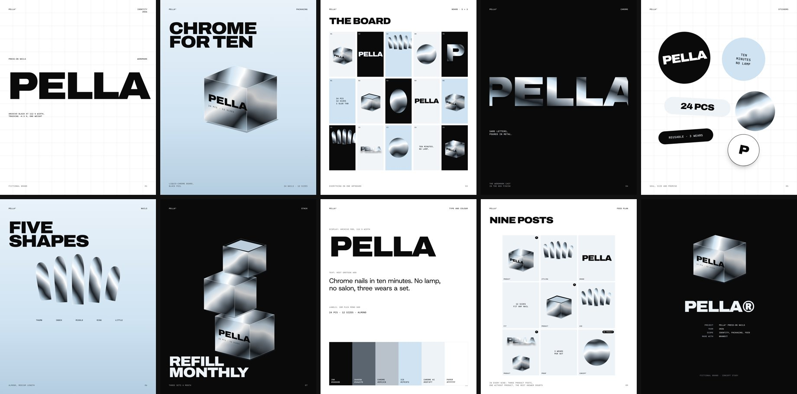

# BrandIt

<p>


</p>

**A library of reusable social posts and ads in one studio identity.** Pick a template, write your line, and
export it as a square post, a portrait post, a story, a landscape banner and a link card. The same templates run
in the browser studio, in Framer and on any web page.

**Live:** [Studio](https://denysovski.github.io/BrandIt/studio/) · [VESSEL](https://denysovski.github.io/BrandIt/showcase/) ·
[KALT](https://denysovski.github.io/BrandIt/showcase/kalt.html) · [PELLA](https://denysovski.github.io/BrandIt/showcase/pella.html)



## The identity

BrandIt follows the way modern studios brand themselves: one grotesk in two weights, black, white, grey and one
loud colour, big type next to tiny type, and compositions that are asymmetric but always aligned to a grid.
Small text sits in the corners, big words run off the edge, and photographs do the colour work.

Two voices live in the same library:

- **Studio**: Host Grotesk at 400 and 500, ink, paper and signal red. Stat posters, year marks, statements,
  hiring, events, quotes.
- **Court**: condensed capitals (Anton) in mint and electric blue over black and white sport photography, with a
  grainy brush stroke and a star mark. Partners, contests, coaches, match days, results.

A third family, **Commerce**, covers products, sales, launches, tips and announcements in the studio voice.

## Studio

Open [`studio/`](https://denysovski.github.io/BrandIt/studio/). Sign in, pick a template, add your photo and logo, and export it. Four screens are switched from the dock at the bottom.

| Screen | What you do there |
| --- | --- |
| Library | browse 111 templates by style: Minimal, Gradient, Professional, Bold photo, Editorial, Tech & app, Sport. Preview all of them with your own photo, in any format and palette |
| Editor | edit every text, then drag any text in the preview (or nudge it with the arrows). Choose a palette or your own colours for the background, text, accent and both gradient stops. Set the headline, text and label fonts, or import your own TTF, OTF or WOFF. Upload a photo and move or zoom it by dragging or with sliders. Set the overlay strength, import a logo and set its size. Pick one of the five formats or type a custom size. Export as PNG, PNG 2× or SVG |
| Sets | export a campaign of four templates in one go: Launch week, Gradient story, Run club, App release, Shop drop, Growth report, Team and events |
| Brands | save as many brands as you need, each with a name, short mark or logo, handle, colours and fonts. Switching the brand in the top bar re-skins the whole library |


**How the templates stay responsive.** Every size inside an ad is set in container units: one unit is 1 % of the
shorter side of the ad. Any width and height works, including a custom size, and a few rules rearrange the
layout for wide and tall formats.

**Real effects.** Blur, motion streaks, halftone and duotone are applied to your own photo with CSS filters and
blend modes. They are not baked into the template, so they work on any photo and in the exported PNG.

**Your data.** Sign-in is a local demo. Accounts, brands, logos, imported fonts, texts and settings are saved in
this browser's localStorage. Nothing is sent anywhere. Photos stay in memory only.

**Sound.** The studio plays short synthesised clicks when you navigate and pick things. Turn them off in the
account menu (top right).

## Showcase

Three brand case studies told as Instagram carousels in portrait frames (1080 × 1350). All three brands are
fictional and every picture is drawn in code.

**VESSEL**, 14 frames: a solid scent pressed into stone. It runs from the cover and a statement, through the
product on stage, the warmth ritual as a thermal trace, a vertical wordmark, packaging, three origins, a still
life, wear from day 1 to day 60, a moodboard, type and colour and the seal's construction, to the credits and the
website on a monitor.


**KALT**, 10 frames: cold-process skincare in film grain, ice, frost and brushed steel. The frames are:

- a cover with one small picture in a grain field, labelled on both sides;
- an ice macro;
- the bottle and the hex jar on frost with callout lines;
- water drops;
- a dark card with the wordmark and four text blocks;
- scattered reference pictures on paper;
- the refill jar on ice;
- a formula sheet;
- type and colour;
- the credits.



**PELLA**, 10 frames: press-on nails in liquid chrome. The frames are:

- a heavy black wordmark on a grid sheet;
- a chrome box on ice blue;
- a 5 × 3 board of every element;
- the wordmark cast in chrome;
- stickers;
- five nail shapes;
- a stack of boxes;
- type and colour;
- a nine-post feed plan;
- the credits.



### Three ways to use it

| Where | What you get | Use it when |
| --- | --- | --- |
| [Figma file](https://www.figma.com/design/nHzqyOsHtB5Zl30d1fyuZa) | each brand in its own section ("VESSEL showcase", "KALT showcase", "PELLA showcase") with the frames side by side; every text is a live text layer (Archivo, IBM Plex Mono, Host Grotesk), every drawing a named image layer | you want to edit copy, move things, swap pictures by hand |
| [`showcase/index.html`](showcase/index.html), [`kalt.html`](showcase/kalt.html), [`pella.html`](showcase/pella.html) | the same frames in HTML and CSS; drawings come from [`render.js`](showcase/render.js) (VESSEL) and [`draw.js`](showcase/draw.js) (KALT, PELLA) | you want new variants in code: other tones, other words, more frames |
| [`showcase/frames/`](showcase/frames/) | every frame as PNG (`vessel-01.png`, `kalt-01.png`, `pella-01.png` …), ready to post | you just need the carousel |

### How it works

- **Frames are plain HTML.** Each frame is a `<section class="fr">` of 1080 × 1350 with absolutely placed
  text blocks: tiny mono labels in the four corners, one big line set in Archivo at 125 % width, and one or
  two drawings. Change a word in `index.html` and the frame changes.
- **Drawings are functions.** `render.js` exports four reusable components:
  - `puck({ tone, view, wear, mark, ring, size })`: the stone seal from above or at three quarters, in
    `slate`, `bone`, `ash` or `glacier`, with any letter as the monogram, ring text, and `wear` from 0 to 1;
  - `carton({ tone, w })`: the white carton with a round window and the puck inside;
  - `heat({ w, h, shape, seed })`: the banded thermal trace (`thumb`, `smear` or `ring`);
  - `land(kind)`: a foggy landscape (`glacier`, `pine`, `ash`).
  Use them for any product that is a round object: soap, a candle, a cosmetic, a coaster, a coin.
- **`draw.js` adds materials** for KALT and PELLA:
  - `grain()`: a film-grain ground;
  - `ice()`: an ice macro;
  - `frost()`: a snow floor;
  - `drops()`: water on skin;
  - `bottle()`: a brushed-steel pump bottle;
  - `jar()`: a hexagonal steel jar;
  - `chromeBox()`: a liquid-chrome box, closed or open;
  - `chromeWord()`: any word cast in chrome;
  - `chromeBlob()`: a round chrome sticker;
  - `nail()`: a chrome press-on nail.

  Every function takes a `seed`, so each call gives a new variant.
- **Export.** Open any showcase page with `?export` (for example `showcase/kalt.html?export`) and every frame renders at its real size. The PNGs in
  `showcase/frames/` were made that way.
- **Assets.** Every drawing of every frame is also in [`showcase/assets/`](showcase/assets/) as a transparent
  PNG, named by frame and part (`03-product-carton.png`). [`figma-layers.json`](showcase/assets/figma-layers.json)
  maps each file to its layer in the Figma file.

### Make your own

1. Copy `showcase/index.html`, rename the brand, and rewrite the copy frame by frame.
2. Change tones in `TONES` inside `render.js` (three colours per stone) and the page colours in `:root`.
3. Replace drawings with real photography where you have it: any `` placed in a frame works.
4. Export with `?export`, or rebuild the Figma frames from your version.

No photography and no paid image generation were used: everything is drawn in code.

## Feed rhythm

A carousel sells one post; the grid sells the brand. BrandIt plans a feed with a simple rule, learned from
Tonya Drozdova's video on planning a product brand's Instagram
([instagram.com/p/DdRUHR4NLUF](https://www.instagram.com/p/DdRUHR4NLUF/)) and written here in our own words:

- **At least 2 in every 6 posts show the product alone**, clearly, with nothing else competing.
- **At most 1 in every 9 posts has no product.** Make it a brand moment: the logo, a texture, a concept shot.
- **The rest answer doubts before they are asked:** how it is used, how it fits, what it is made of, who it is
  for, what it looks like after a month. Each of these posts still shows the product, just in context.

Frame 09 of PELLA puts the rule on a 3 × 3 grid: the product posts are tagged `P`, there is one concept post
without product, and fit, proof, use and styling fill the rest. Plan the next nine posts on the same grid before
designing any of them.

## Reusable ad components

Both parts of BrandIt are built from the same idea: a component is a function that takes content and returns a
finished picture at any size.

| Component | File | Takes | Gives |
| --- | --- | --- | --- |
| 24 ad templates | `lib/brandit.js` | template id, theme, texts, brand, photo | a post or ad in five formats |
| Stone seal | `showcase/render.js` `puck()` | tone, view, wear, monogram, ring text | a product render |
| Carton | `showcase/render.js` `carton()` | tone, width | packaging with a window |
| Heat trace | `showcase/render.js` `heat()` | size, shape, seed | the thermal accent |
| Landscape | `showcase/render.js` `land()` | kind | an origin tile |
| Materials | `showcase/draw.js` `grain()` `ice()` `frost()` `drops()` | size, seed | grounds and textures |
| Steel packaging | `showcase/draw.js` `bottle()` `jar()` | size, wordmark | product renders |
| Chrome | `showcase/draw.js` `chromeBox()` `chromeWord()` `chromeBlob()` `nail()` | size, word, seed, open | packaging, type and stickers in liquid chrome |

## Formats

| Format | Size |
| --- | --- |
| Square post | 1080 × 1080 |
| Portrait post | 1080 × 1350 |
| Story and reel | 1080 × 1920 |
| Landscape | 1920 × 1080 |
| Link and LinkedIn | 1200 × 627 |

Every template is sized in container units, so it also works at any other size.

## Use the library in code

```html
<style id="bi"></style>
<div style="width:540px;aspect-ratio:4/5" id="ad"></div>
<script type="module">
  import { render, css } from 'https://cdn.jsdelivr.net/gh/denysovski/BrandIt@main/lib/brandit.js';
  document.getElementById('bi').textContent = css('https://cdn.jsdelivr.net/gh/denysovski/BrandIt@main/fonts/');
  document.getElementById('ad').innerHTML = render('stat-poster', {
    theme: 'signal',
    fields: { l1: '9 people', l2: '& 31 awards', l3: '112 projects' },
    brand: { name: 'north.', short: 'NO' },
  });
</script>
```

`toSVG()` and `toPNG()` turn any ad into a file with fonts and pictures embedded.

## Framer

[`framer/BrandItAd.tsx`](framer/BrandItAd.tsx) is a code component with controls for template, theme, six texts,
photo and brand. Paste **Copy settings** from the studio into its Settings control to bring an ad across exactly.
Setup and the field order of each template are in [framer/README.md](framer/README.md).

## Templates

| Studio | Court | Commerce |
| --- | --- | --- |
| Stat poster | Become a partner | Product |
| Year mark | Contest | Sale |
| Wordmark over photo | New coach | Launch date |
| Indented statement | Match day | Three tips |
| We are hiring | Result | Announcement |
| New work | Academy | Carousel cover |
| Client quote | | |
| Event | | |
| Services list | | |
| Book a call | | |
| Big number | | |
| Team | | |

## Before you post

- Replace the placeholder silhouettes with real photography.
- Text in [brackets] must come from a real person: quotes and names are never invented.
- Check numbers, dates and prices against their source.

## Licence

Code under the [MIT licence](LICENSE). Host Grotesk, Anton, Archivo and IBM Plex Mono are under the SIL Open Font License 1.1. The look
is inspired by studio identities studied for [ProUI](https://github.com/denysovski/ProUI); no artwork, logos or
copy from any studio or client is included.
