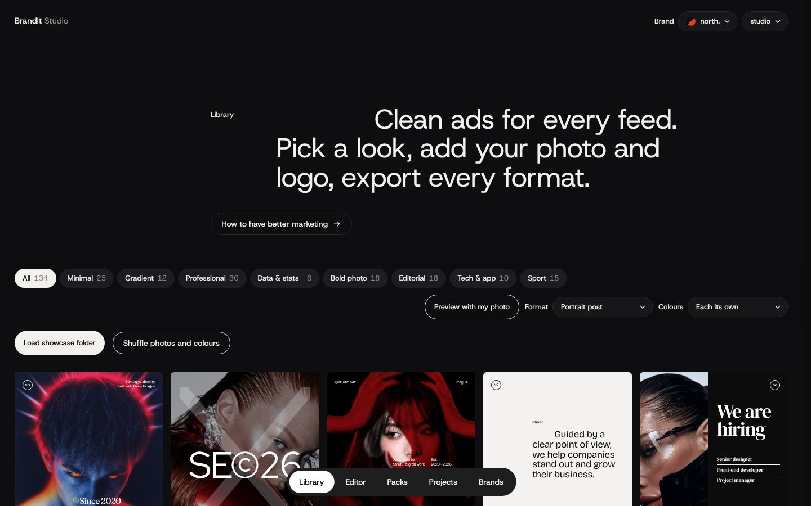
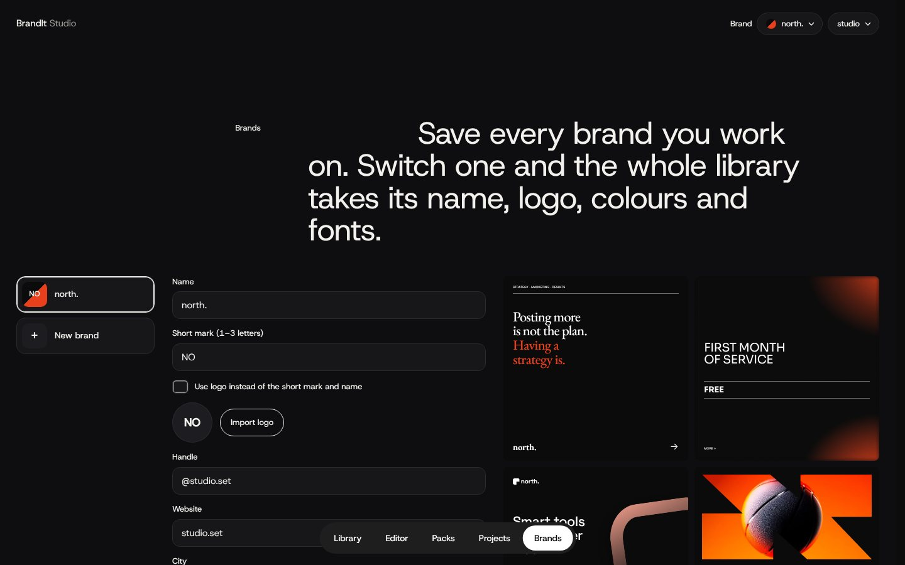
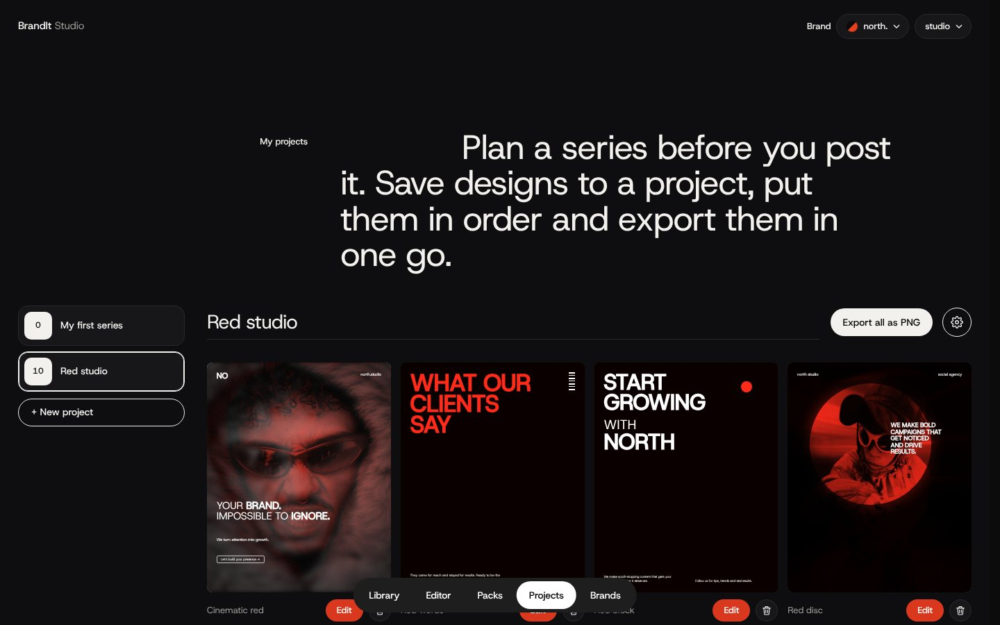

<div align="center">

# BrandIt Studio

**Clean ads for every feed. Pick a look, add your photo and logo, export every format.**

A browser studio for social media and web ads: 221 templates, 13 formats, 40 fonts, a full editor with rulers and guides, packs of matching posts and projects for planning a series. No framework, no build step, no server.

[**Open the studio**](https://denysovski.github.io/BrandIt/studio/) &nbsp;·&nbsp; [Library](https://denysovski.github.io/BrandIt/studio/#/library) &nbsp;·&nbsp; [Packs](https://denysovski.github.io/BrandIt/studio/#/sets) &nbsp;·&nbsp; [Marketing guide](https://denysovski.github.io/BrandIt/studio/#/guide)


</div>

---

## At a glance

| | |
|---|---|
| **Templates** | 221 designs in twelve styles: Minimal, Gradient, Professional, Data & stats, Bold photo, Brand identity, Shapes, Carousel, Event, Editorial, Tech & app and Sport. Every one is a photo and text, so your own picture finishes it. |
| **Formats** | 13 sizes for Instagram, stories, Pinterest, YouTube, X, Facebook, banners and print, plus any custom size. Layouts adapt with container queries. |
| **Editor** | Text, photo, colours, type, size and series tabs. Rulers, mirrored magnetic guides, zoom to the pointer, drag to pan, and text you drag straight in the preview. |
| **Type** | 40 self-hosted fonts in four groups (sans, display, serif, mono), or import your own. The library pairs two fonts at random on every refresh. |
| **Colour** | 38 palettes, 12 photo gradients, a custom colour picker with opacity, and your own saved palettes. |
| **Packs** | Fifteen packs of ten or more posts that share fonts, colours and components. Switch one to your brand and save it as a project. |
| **Profile** | Your own page with a cover, a photo, a short line about you and your numbers. Publish posts from your projects, copy a link to them, and browse a small simulated community: follow people, like and save their designs, and open any of them in the editor as your own copy. Everything stays in this browser. |
| **Projects** | Plan a series, drag the posts into order, edit them later and export them all at once. |
| **Brands** | Name, logo, colours and fonts per brand. Switch the brand and the whole library follows. |
| **Privacy** | Accounts, brands, photos and projects stay in your browser. Nothing is uploaded. |

---

## The library



The first screen after you sign in. Every template is shown with a real photo, and on every refresh the photos, palettes and font pairs are shuffled, so the library never looks the same twice. Filter by style, preview every template with your own photo, and set the format and colours for the whole grid. Clicking a template opens it in the editor with exactly the look you saw. The *How to have better marketing* link leads to a short, practical guide: the sentence your brand stands for, the people you want, your kit, the photo, one job per post, a weekly rhythm and a checklist before you post.

## The editor


Tabs on the left for text, photo, layers, colours, size and series. Fonts sit at the top of *Text*, and every font menu shows the real font name and can import your own TTF, OTF or WOFF. In *Colours* you can add a shade and point it with an arrow in the preview: the direction sets where it darkens, the length how strong it is. Undo and redo are kept in the browser, so they still work after a reload. A text, picture or photo is picked with the first click and moved with the next, and when a template uses several different photos each one is framed on its own. In *Layers* you add your own pictures to any template, drag them into place, set their size, rotation, corners, opacity, brightness, contrast, saturation and blur, and order every text and picture from back to front, or hide it, as in Photoshop. The artboard in the middle has rulers on two sides: drag guides out of them, and with *Mirror* on every guide gets a twin at the same distance from the opposite edge. Drag any text straight in the preview. It snaps to the centre, the edges and your guides, more strongly when you move slowly, and with **Alt** held it moves freely. The mouse wheel zooms into the point under the pointer, a pinch does the same on a phone, and dragging the empty area pans. On the right are every format and palette, ready-made photo gradients, and at the top the project picker, *Save* and an export menu with PNG, PNG at 2×, SVG and the settings as JSON.

## Brands



Save as many brands as you like. Each has a name, a short mark, a round logo, a handle, a website and a city, five brand colours set with the same colour picker as the editor, a headline font and a text font. A contrast check tells you whether the text is readable on the background. Switch the brand in the top bar and the whole library takes its name, logo, colours and fonts.

## My projects



Plan a series before you post it. Press *Save* in the editor, or save a whole pack of ten matching posts at once. Hold a post and drag it to a new place; the others slide aside and the numbering on each post follows the order. *Edit* opens a post in the editor, the bin removes it after a confirmation, and the settings button next to *Export all as PNG* renames or deletes the project.

---

## What comes next

- **Packs from your own photos.** Load a folder and BrandIt groups the photos by colour, light and subject, then builds a pack whose posts share that look, so a whole series feels like one shoot.
- **More packs and templates.** New styles for restaurants, real estate, fashion drops and events, each as a pack of ten.
- **Carousel export.** One ZIP for Instagram and one PDF for LinkedIn carousels, numbered in order.
- **Motion.** Short animated versions of the templates as MP4 and GIF for stories and reels.
- **Brand from a link.** Paste a website or upload a logo and get a first brand kit with its colours and fonts.
- **Readability checks per post.** A warning when a headline is too small for a phone or too low in contrast over the photo.
- **Sync between devices.** An optional account, so your brands and projects follow you from the laptop to the phone.
- **A real community.** Today the profile and its people are simulated in the browser. Next, published posts go to a shared feed others can actually follow.

---

## Where your data is

Everything is saved in your browser's local storage: your account, brands, logos, fonts, texts, colours, positions, palettes and projects with their photos. Photos are scaled down to 1600 px so they fit. Showcase photos you load from a folder are kept in IndexedDB.

To keep your work safe or move it to another computer, open **Settings, Download backup**. Load the file later with **Restore from file**. Clearing your browser data deletes everything that is not in a backup.

## Run it locally

```bash
git clone https://github.com/denysovski/BrandIt.git
cd BrandIt
python3 -m http.server 8000
# open http://localhost:8000/studio/
```

## Structure

| Path | What it holds |
|---|---|
| `studio/` | The app: `index.html`, `studio.js`, `studio.css` and the built-in photos. |
| `lib/brandit.js` | Rendering, formats, palettes, gradients, SVG and PNG export. |
| `lib/motion.js`, `lib/more*.js` | The templates and their CSS, plus the font list. |
| `fonts/` | 40 self-hosted WOFF2 families with their licence files. |

## Licence

Code under the [MIT licence](LICENSE). All fonts are free under the SIL Open Font License, and their licence files are in [`fonts/`](fonts/).
