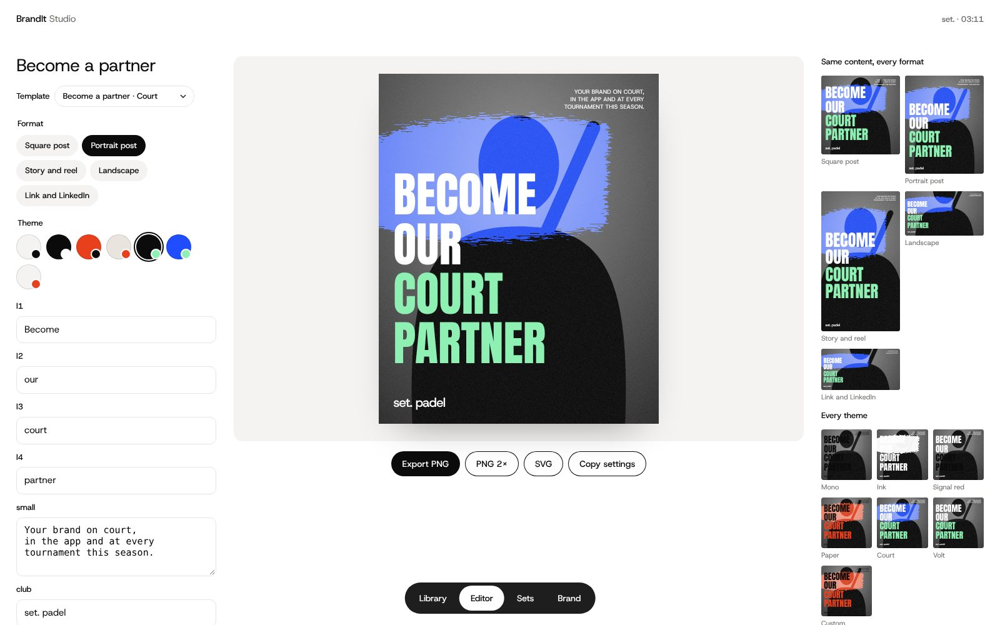
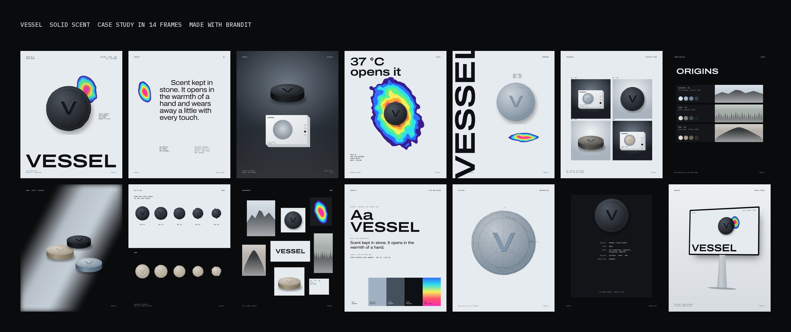

# BrandIt

<p>


</p>

**A library of reusable social posts and ads in one studio identity.** Pick a template, write your line, and
export it as a square post, a portrait post, a story, a landscape banner and a link card. The same templates run
in the browser studio, in Framer and on any web page.


## The identity

BrandIt follows the way modern studios brand themselves: one grotesk in two weights, black, white, grey and one
loud colour, big type next to tiny type, and compositions that are asymmetric but always aligned to a grid.
Small text sits in the corners, big words run off the edge, and photographs do the colour work.

Two voices live in the same library:

- **Studio**: Host Grotesk at 400 and 500, ink, paper and signal red. Stat posters, year marks, statements,
  hiring, events, quotes.
- **Court**: condensed capitals (Anton) in mint and electric blue over black and white sport photography, with a
  grainy brush stroke and a star mark. Partners, contests, coaches, match days, results.

A third family, **Commerce**, covers products, sales, launches, tips and announcements in the studio voice.

## Studio

Open [`studio/`](studio/index.html) (or the GitHub Pages site of this repository). Four screens, switched from
the dock at the bottom:

| Screen | What you do there |
| --- | --- |
| Library | browse all 24 templates by family, in any format and theme |
| Editor | write the text, switch format and theme, upload a photo, see every format and theme at once, export PNG, PNG 2× or SVG |
| Sets | pick a campaign (Studio launch, Hiring week, Court season, Shop drop, Year in review) and export it in one go |
| Brand | set your name, short mark, handle, website, city and a custom theme with a contrast check |




Everything stays in your browser: text and brand settings in local storage, photos only in memory.

## Showcase

A case study told as an Instagram carousel: 14 portrait frames (1080 × 1350) for **VESSEL**, a fictional solid
scent pressed into stone. Cover, statement, product on stage, the warmth ritual as a thermal trace, a vertical
wordmark, packaging, three origins, still life, wear from day 1 to day 60, moodboard, type and colour, the seal's
construction, credits and the website on a monitor.



Everything is drawn in HTML, CSS and SVG: the stone, the carton, the heat trace and the landscapes. No photography
and no paid image generation were used. Open [`showcase/`](showcase/index.html) to see the frames live; the
exported PNGs are in [`showcase/frames/`](showcase/frames/). To make your own, copy `showcase/index.html`, change
the copy and the tones in `render.js`, and drop real photographs into any frame.

## Formats

| Format | Size |
| --- | --- |
| Square post | 1080 × 1080 |
| Portrait post | 1080 × 1350 |
| Story and reel | 1080 × 1920 |
| Landscape | 1920 × 1080 |
| Link and LinkedIn | 1200 × 627 |

Every template is sized in container units, so it also works at any other size.

## Use the library in code

```html
<style id="bi"></style>
<div style="width:540px;aspect-ratio:4/5" id="ad"></div>
<script type="module">
  import { render, css } from 'https://cdn.jsdelivr.net/gh/denysovski/BrandIt@main/lib/brandit.js';
  document.getElementById('bi').textContent = css('https://cdn.jsdelivr.net/gh/denysovski/BrandIt@main/fonts/');
  document.getElementById('ad').innerHTML = render('stat-poster', {
    theme: 'signal',
    fields: { l1: '9 people', l2: '& 31 awards', l3: '112 projects' },
    brand: { name: 'north.', short: 'NO' },
  });
</script>
```

`toSVG()` and `toPNG()` turn any ad into a file with fonts and pictures embedded.

## Framer

[`framer/BrandItAd.tsx`](framer/BrandItAd.tsx) is a code component with controls for template, theme, six texts,
photo and brand. Paste **Copy settings** from the studio into its Settings control to bring an ad across exactly.
Setup and the field order of each template are in [framer/README.md](framer/README.md).

## Templates

| Studio | Court | Commerce |
| --- | --- | --- |
| Stat poster | Become a partner | Product |
| Year mark | Contest | Sale |
| Wordmark over photo | New coach | Launch date |
| Indented statement | Match day | Three tips |
| We are hiring | Result | Announcement |
| New work | Academy | Carousel cover |
| Client quote | | |
| Event | | |
| Services list | | |
| Book a call | | |
| Big number | | |
| Team | | |

## Before you post

- Replace the placeholder silhouettes with real photography.
- Text in [brackets] must come from a real person: quotes and names are never invented.
- Check numbers, dates and prices against their source.

## Licence

Code under the [MIT licence](LICENSE). Host Grotesk, Anton, Archivo and IBM Plex Mono are under the SIL Open Font License 1.1. The look
is inspired by studio identities studied for [ProUI](https://github.com/denysovski/ProUI); no artwork, logos or
copy from any studio or client is included.
