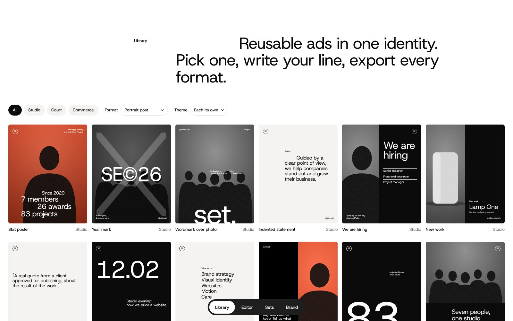

# BrandIt Studio

Clean, ready-made ads for Instagram and the web. Pick a template, add your photo and logo, change the text and export it.

**Open it: [denysovski.github.io/BrandIt/studio](https://denysovski.github.io/BrandIt/studio/)**

## How to use it

1. **Sign in.** Create an account with any email and password. It exists only in your browser.
2. **Pick a template** in the Library. Filter by style: Minimal, Gradient, Professional, Data & stats, Bold photo, Editorial, Tech & app or Sport. Use *Preview with my photo* to see every template with your own picture.
3. **Edit it** in the Editor:
   - **Text:** rewrite any line. Each text has its own font, size and colour, or tick *One font for every text*. Click a text in the preview and drag it. It snaps to the grid and the centre and stays inside the edges.
   - **Photo:** upload a photo, then drag it in the preview, or use the sliders to move, zoom and darken it. If a design has several photos, each one has its own upload button. Import your logo and set its size.
   - **Colours:** pick one of 38 ready-made palettes, or set your own colours, including opacity, with the colour picker. Save your combination as *My palette* to reuse it.
   - **Type:** choose fonts for headlines, text and labels, or import your own TTF, OTF or WOFF file.
   - **Size:** 13 formats for Instagram, stories, Pinterest, YouTube, X, Facebook, banners and print, or any custom width and height. The ad adjusts itself.
   - **Series:** number the posts of a carousel with squares, dots, story bars or numbers.
4. **Export** as PNG, PNG at 2× or SVG.

**Brands.** Save as many brands as you like, each with its own name, logo, colours and fonts. Switch the brand in the top bar and every template changes to it.

**Projects.** Press *Save to project* to plan a series before you post it. In *My projects* (in the dock or your account menu), put the posts in order, edit them later and export them all at once. Numbering follows the order automatically.

**Sets.** Export a whole campaign of four matching posts in one click.

## Where your data is

Everything is saved in your browser's local storage: your account, brands, logos, fonts, texts, colours, positions, palettes and projects with their photos. Nothing is uploaded anywhere. Photos are scaled down to 1600 px so they fit, and kept with the projects you save them to.

To keep your work safe or move it to another computer, open **Settings → Download backup**. You get one file with all of it, including the current photo. Load it later with **Restore from file**. Clearing your browser data deletes everything that is not in a backup.

In Settings you can also turn the click sound and the motion effects on or off, and switch between light and dark mode.

## Good to know

- Every template is just a photo and text. Swap in your own and the ad is finished.
- Blur, motion and colour effects are applied to whatever photo you upload, so they always match it.
- For a feed that sells, follow a simple rhythm. In every six posts, at least two show only the product. In every nine, at most one shows no product. Learned from [Tonya Drozdova](https://www.instagram.com/p/DdRUHR4NLUF/).

## Licence

Code under the [MIT licence](LICENSE). All fonts are free under the SIL Open Font License, and their licence files are in [`fonts/`](fonts/).
