<div align="center">

# BrandIt Studio

**Clean ads for every feed. Pick a look, add your photo and logo, export every format.**

A browser studio for social media and web ads: 134 templates, 13 formats, 40 fonts, a full editor with rulers and guides, packs of matching posts and projects for planning a series. No framework, no build step, no server.

[**Open the studio**](https://denysovski.github.io/BrandIt/studio/) &nbsp;·&nbsp; [Library](https://denysovski.github.io/BrandIt/studio/#/library) &nbsp;·&nbsp; [Packs](https://denysovski.github.io/BrandIt/studio/#/sets) &nbsp;·&nbsp; [Marketing guide](https://denysovski.github.io/BrandIt/studio/#/guide)


<br>


</div>

---

## At a glance

| | |
|---|---|
| **Templates** | 134 designs in eight styles: Minimal, Gradient, Professional, Data & stats, Bold photo, Editorial, Tech & app and Sport. Every one is a photo and text, so your own picture finishes it. |
| **Formats** | 13 sizes for Instagram, stories, Pinterest, YouTube, X, Facebook, banners and print, plus any custom size. Layouts adapt with container queries. |
| **Editor** | Text, photo, colours, type, size and series tabs. Rulers, mirrored magnetic guides, zoom to the pointer, drag to pan, and text you drag straight in the preview. |
| **Type** | 40 self-hosted fonts in four groups (sans, display, serif, mono), or import your own. The library pairs two fonts at random on every refresh. |
| **Colour** | 38 palettes, 12 photo gradients, a custom colour picker with opacity, and your own saved palettes. |
| **Packs** | Nine packs of ten posts that share fonts, colours and components. Switch one to your brand and save it as a project. |
| **Projects** | Plan a series, drag the posts into order, edit them later and export them all at once. |
| **Brands** | Name, logo, colours and fonts per brand. Switch the brand and the whole library follows. |
| **Privacy** | Accounts, brands, photos and projects stay in your browser. Nothing is uploaded. |

---

## Start

| | |
|---|---|
| 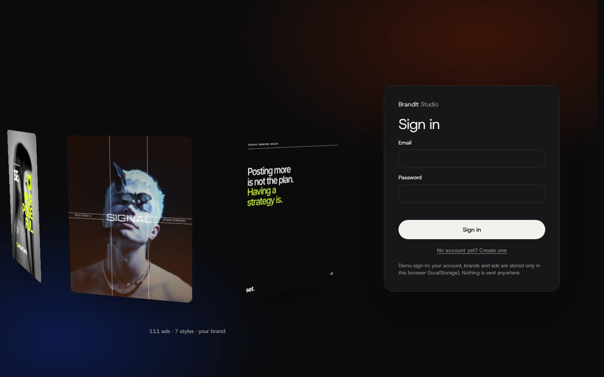 **Sign in.** An account that exists only in this browser, next to a live wall of templates. | 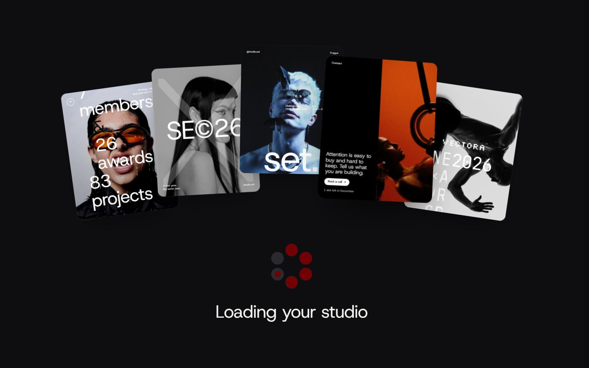 **Loading your studio.** Five posts with different photos fan out and tilt towards the pointer while the flower fills, petal by petal. |
|  **Library.** Filter by style, preview every template with your own photo, and choose the format and colours for the whole grid. | 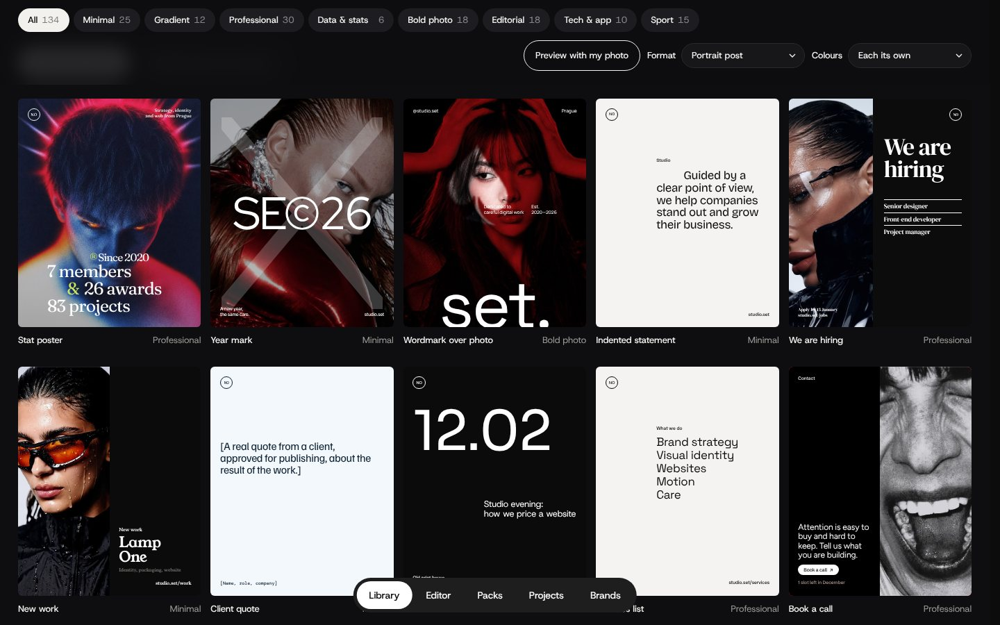 **Grid.** Photos, palettes and font pairs are shuffled on every refresh. Opening a template keeps the same look in the editor. |

---

## Editor

| | |
|---|---|
| 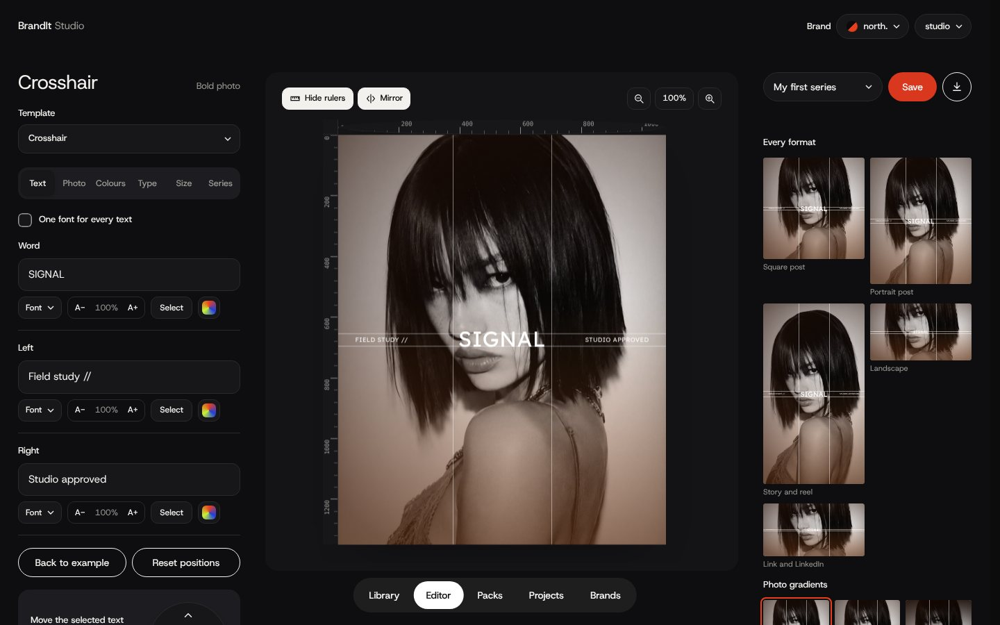 **Editor.** Tabs on the left, the artboard with rulers in the middle, every format and palette on the right. Save and export sit at the top. | 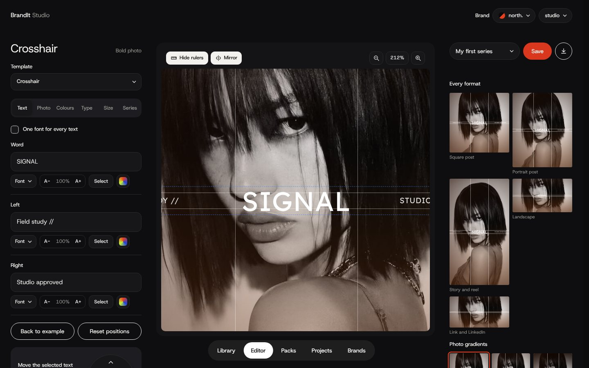 **Zoom and pan.** The mouse wheel zooms into the point under the pointer. Drag the empty area to move around. |
| 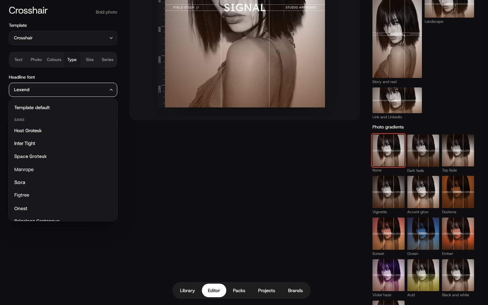 **Type.** Headline, text and label fonts, grouped and previewed in their own face. | 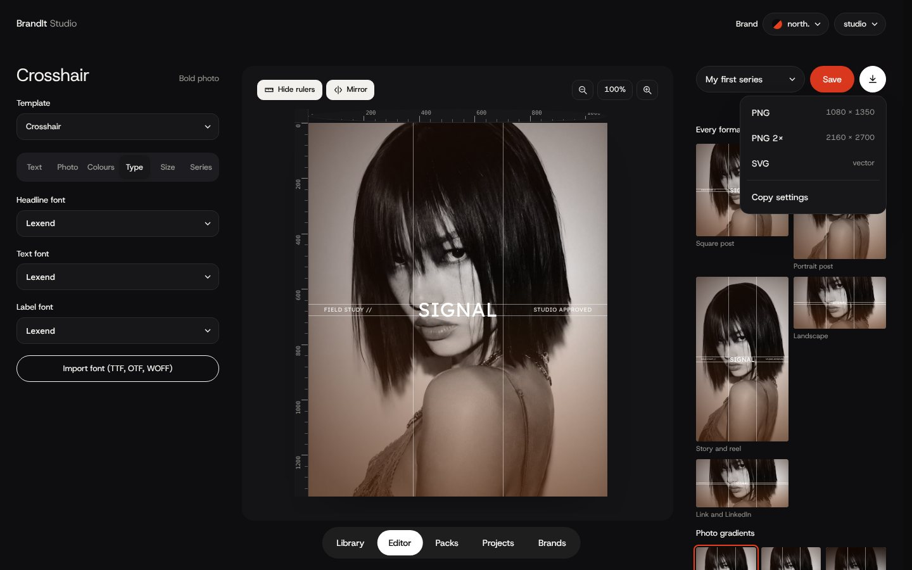 **Export.** PNG, PNG at 2×, SVG or the settings as JSON, with the exact pixel size. |

Drag any text in the preview. It snaps to the centre, the edges and your guides, more strongly when you move slowly. Hold **Alt** to move it freely. Drag guides out of the rulers; with *Mirror* on, each guide gets a twin at the same distance from the opposite edge.

---

## Packs, projects and brands

| | |
|---|---|
| 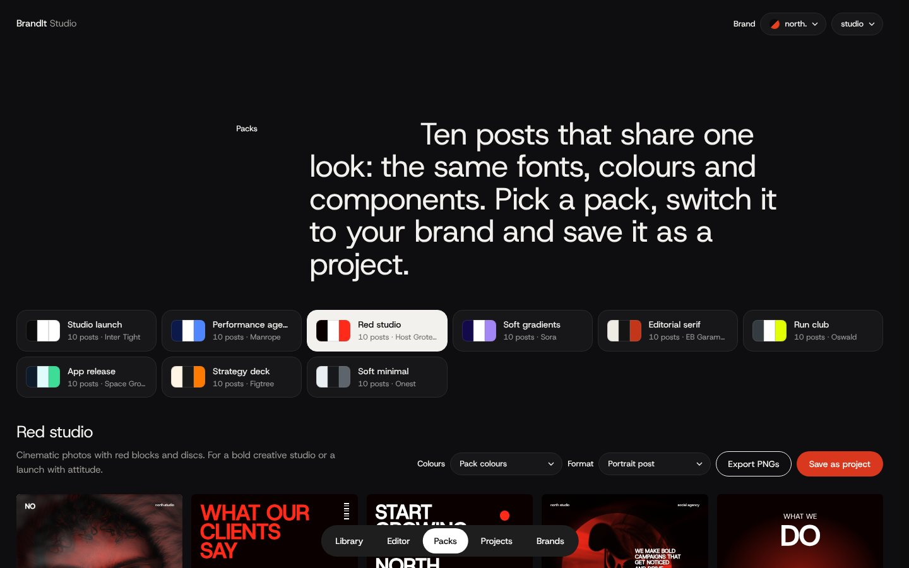 **Packs.** Ten posts in one look. Use the pack colours or your brand colours, export the PNGs or save the pack as a project. |  **Projects.** Hold a post and drag it to a new place. Edit opens it in the editor, the bin removes it after a confirmation. |
|  **Brands.** A round logo, brand colours with the same picker as the editor, two brand fonts and a contrast check. | 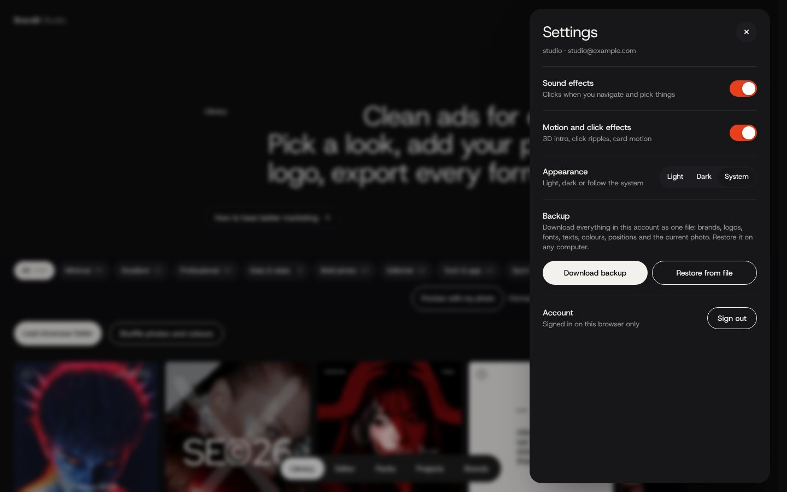 **Settings.** Sound, motion, light or dark mode, and a backup of everything in one file. |

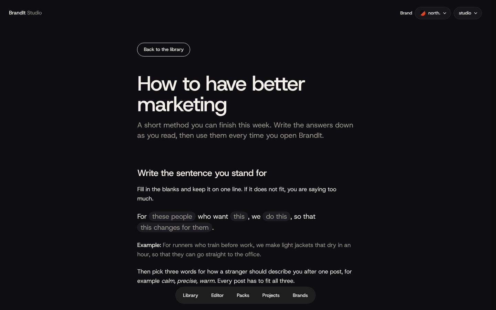
**How to have better marketing.** A short method you can finish in a week: the sentence you stand for, the people you want, your kit, the photo, one job per post, a weekly rhythm, profiles to learn from and a checklist before you post.

---

## Phone

| | |
|---|---|
| 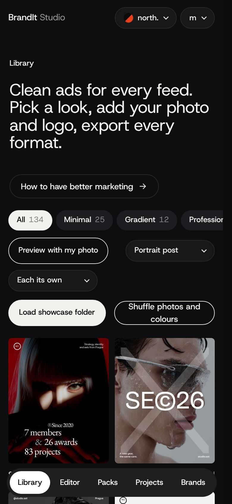 | 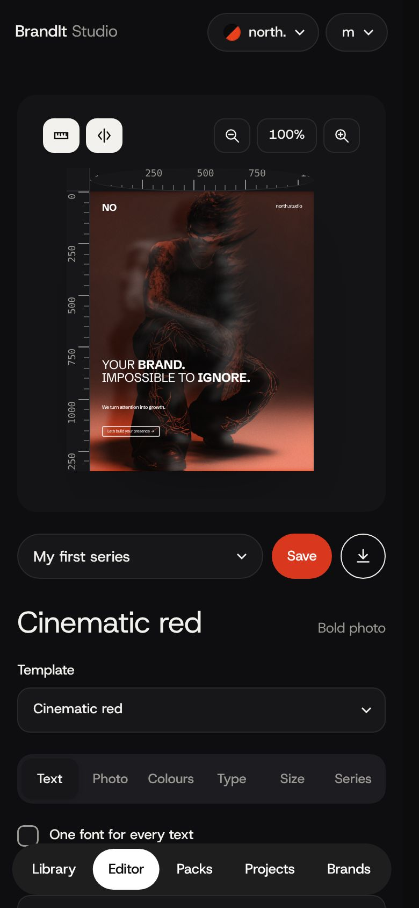 |

---

## Where your data is

Everything is saved in your browser's local storage: your account, brands, logos, fonts, texts, colours, positions, palettes and projects with their photos. Photos are scaled down to 1600 px so they fit. Showcase photos you load from a folder are kept in IndexedDB.

To keep your work safe or move it to another computer, open **Settings, Download backup**. Load the file later with **Restore from file**. Clearing your browser data deletes everything that is not in a backup.

## Run it locally

```bash
git clone https://github.com/denysovski/BrandIt.git
cd BrandIt
python3 -m http.server 8000
# open http://localhost:8000/studio/
```

## Structure

| Path | What it holds |
|---|---|
| `studio/` | The app: `index.html`, `studio.js`, `studio.css` and the built-in photos. |
| `lib/brandit.js` | Rendering, formats, palettes, gradients, SVG and PNG export. |
| `lib/motion.js`, `lib/more*.js` | The templates and their CSS, plus the font list. |
| `fonts/` | 40 self-hosted WOFF2 families with their licence files. |

## Licence

Code under the [MIT licence](LICENSE). All fonts are free under the SIL Open Font License, and their licence files are in [`fonts/`](fonts/).
